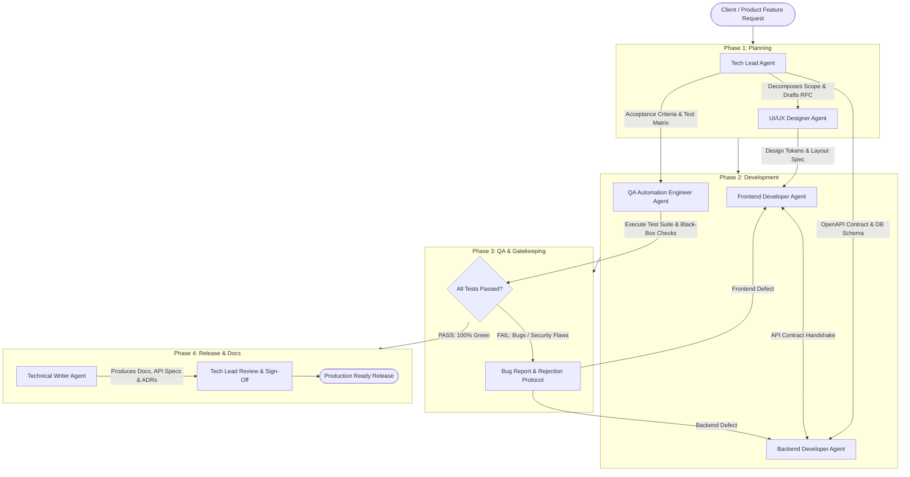

# Autonomous Multi-Agent Software Agency Framework

Welcome to the **Autonomous Multi-Agent Software Agency** specification. This framework models a high-performing digital product engineering team composed of specialized AI agent personas collaborating through structured contracts, clear responsibilities, and automated feedback loops.

---

## 1. Agency Roster & Org Matrix (All Roles: 15+ Years Seniority)

| Role | Agent File | Experience | Primary Core Stack | Key Mission |
| :--- | :--- | :--- | :--- | :--- |
| **Tech Lead / Architect** | [`tech_lead.md`](./tech_lead.md) | 15+ Years | System Architecture, RFCs, ERDs, Git PR review | Architecture design, task decomposition, technical roadmap, and code sign-off |
| **UI/UX Designer** | [`ui_ux_designer.md`](./ui_ux_designer.md) | 15+ Years | Design Systems, daisyUI Theming, Tailwind CSS | Dashboard layouts, daisyUI semantic tokens, responsive drawer shells, WCAG AA |
| **Backend Developer** | [`backend_developer.md`](./backend_developer.md) | 15+ Years | Python 3.12+, FastAPI, SQLAlchemy 2, Pydantic v2 | Robust async REST APIs, DB migrations, secure business logic & services |
| **Frontend Developer** | [`frontend_developer.md`](./frontend_developer.md) | 15+ Years | React 19 / Vite, TypeScript 5+, Zustand, Tailwind CSS + daisyUI | Dashboard components (stats, drawer, table), daisyUI theming, Zustand state, XSS-safe code |
| **QA Automation Engineer** | [`qa_automation_engineer.md`](./qa_automation_engineer.md) | 15+ Years | Pytest, Playwright, HTTPX, Black-Box Fuzzing | Automated integration tests, black-box testing, regression verification, bug rejection loop |
| **Technical Writer** | [`technical_writer.md`](./technical_writer.md) | 15+ Years | Markdown, OpenAPI, Mermaid, MkDocs/Docusaurus | API references, setup runbooks, architecture decision records (ADRs), user guides |

---

## 2. Collaboration & Handoff Pipeline

The agency operates using an **Iterative Agile Pipeline with Feedback Loops**. Rather than a rigid waterfall handoff, QA and Tech Lead hold explicit gatekeeper authority to reject work and request targeted rework from developers.

---

## 3. Communication & Handoff Contracts

To eliminate ambiguity between agents, every role consumes and produces standardized deliverable schemas:

### Handoff 1: Tech Lead &rarr; Team
- **Deliverables**:
  - `RFC_<feature>.md`: Architecture overview, data model, sequence diagram.
  - `contracts/openapi_draft.json`: Target API endpoints and request/response models.
  - `tasks/ticket_breakdown.json`: Granular, actionable task assignments for UI/UX, Backend, Frontend, and QA.

### Handoff 2: UI/UX Designer &rarr; Frontend Developer
- **Deliverables**:
  - `specs/design_spec_<feature>.md`: Screen layouts, interaction states (idle, loading, error, success).
  - `theme/tokens.json` & Tailwind class mappings.
  - Responsive breakpoints breakdown (`mobile`, `tablet`, `desktop`).

### Handoff 3: Backend & Frontend &rarr; QA Automation Engineer
- **Backend Deliverables**:
  - Executable FastAPI application code with unit test suite (`pytest tests/unit`).
  - Running API instance or OpenAPI specification ready for integration tests.
- **Frontend Deliverables**:
  - Running React build/dev server or component preview.
  - Component tests and DOM access hooks (`data-testid`).

### Handoff 4: QA Rejection & Rework Loop (Conditional)
- If tests fail, QA outputs:
  - `QA_DEFECT_REPORT.md`: Exact repro steps, curl commands, expected vs actual behavior, severity rating (P0/P1/P2), and assignment to either Backend or Frontend.
- The assigned developer must fix the defect and re-submit to QA before progressing.

### Handoff 5: QA & Team &rarr; Technical Writer
- **Deliverables**:
  - `docs/api_reference.md`: Verified OpenAPI endpoints with real examples.
  - `docs/guides/<feature>.md`: End-user walkthroughs and configuration guides.
  - `docs/adr/ADR-XXXX.md`: Architectural Decision Records.
  - `CHANGELOG.md`: Summary of changes adhering to Keep a Changelog standards.

---

## 4. How to Run with Agent Runners

Each agent file (`tech_lead.md`, `backend_developer.md`, etc.) contains:
1. **Agent Metadata & Persona**
2. **System Prompt** (copy-pasteable into LangGraph, CrewAI, AutoGen, Claude Agent, or Antigravity subagent configs)
3. **Tool Access & Permissions**
4. **Input / Output Schemas**
5. **Quality Checklists** (including Security and Testing guidelines)

### Execution Example in Frameworks:
- **CrewAI**: Pass each markdown file's System Prompt into the `Agent(role=..., backstory=..., goal=...)` constructor.
- **LangGraph**: Assign each agent as a Graph Node with conditional edges routing based on the QA decision node (`PASS` &rarr; `TechWriter`, `FAIL` &rarr; `Dev`).
- **Antigravity / Local IDE**: Use as context guides or define subagents using Antigravity's `define_subagent` tool.
