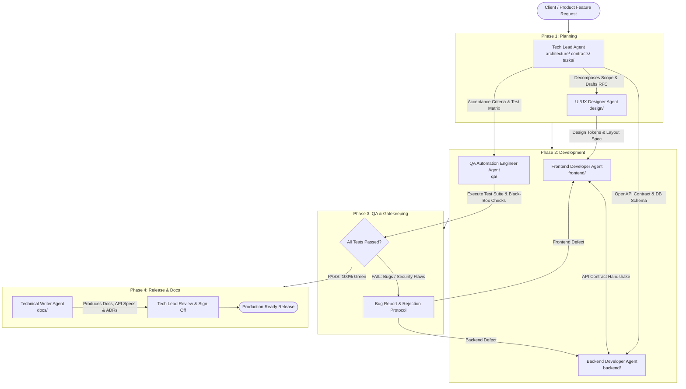

# Autonomous Multi-Agent Software Agency Framework

Welcome to the **Autonomous Multi-Agent Software Agency** specification. This framework models a high-performing digital product engineering team composed of specialized AI agent personas collaborating through structured contracts, clear responsibilities, and automated feedback loops.

---

## 1. Agency Roster & Org Matrix (All Roles: 15+ Years Seniority)

| Role | Agent File | Workspace (write) | Experience | Primary Core Stack | Key Mission |
| :--- | :--- | :--- | :--- | :--- | :--- |
| **Tech Lead / Architect** | [`tech_lead.md`](./tech_lead.md) | `architecture/`, `contracts/`, `tasks/` | 15+ Years | System Architecture, RFCs, ERDs, Git PR review | Architecture design, task decomposition, technical roadmap, and code sign-off |
| **UI/UX Designer** | [`ui_ux_designer.md`](./ui_ux_designer.md) | `design/`, `DESIGN.md` | 15+ Years | Design Systems, daisyUI Theming, Tailwind CSS | Dashboard layouts, daisyUI semantic tokens, responsive drawer shells, WCAG AA |
| **Backend Developer** | [`backend_developer.md`](./backend_developer.md) | `backend/` | 15+ Years | Python 3.12+, FastAPI, SQLAlchemy 2, Pydantic v2, PostgreSQL 16 | Robust async REST APIs, DB migrations, secure business logic & services |
| **Frontend Developer** | [`frontend_developer.md`](./frontend_developer.md) | `frontend/` | 15+ Years | React 19 / Vite, TypeScript 5+, Zustand, Tailwind CSS + daisyUI | Dashboard components (stats, drawer, table), daisyUI theming, Zustand state, XSS-safe code |
| **QA Automation Engineer** | [`qa_automation_engineer.md`](./qa_automation_engineer.md) | `qa/` | 15+ Years | Pytest, Playwright, HTTPX, Black-Box Fuzzing | Automated integration tests, black-box testing, regression verification, bug rejection loop |
| **Technical Writer** | [`technical_writer.md`](./technical_writer.md) | `docs/`, `CHANGELOG.md` | 15+ Years | Markdown, OpenAPI, Mermaid, MkDocs/Docusaurus | API references, setup runbooks, architecture decision records (ADRs), user guides |

### Default Database

**PostgreSQL 16** is the agency default for every project (async via SQLAlchemy 2.0 + `asyncpg`, migrations via Alembic). Development, unit tests, QA integration tests, and production all run on PostgreSQL; SQLite is not used as a substitute. Another engine is allowed only when the client explicitly requires it, and the Tech Lead must record the deviation in an ADR.

### Repository Layout & Ownership

Each agent **writes only inside its own workspace** and treats every other folder as read-only. If a change is needed in another agent's folder, the agent raises it to the owner (or to the Tech Lead for `contracts/`).

```text
.
├── README.md                 # Tech Lead
├── architecture/             # Tech Lead   – RFC_<feature>.md
├── contracts/                # Tech Lead   – openapi.json (single source of truth)
├── tasks/                    # Tech Lead   – sprint_backlog.json
├── DESIGN.md                 # UI/UX       – global design guideline (source of truth)
├── design/                   # UI/UX       – specs/, tokens/
├── backend/                  # Backend     – app/, alembic/, tests/unit/
├── frontend/                 # Frontend    – src/ (+ colocated __tests__/)
├── qa/                       # QA          – tests/integration/, tests/e2e/, reports/
├── docs/                     # Tech Writer – api/, guides/, adr/, DEVELOPMENT.md
└── CHANGELOG.md              # Tech Writer
```

---

## 2. Collaboration & Handoff Pipeline

The agency operates using an **Iterative Agile Pipeline with Feedback Loops**. Rather than a rigid waterfall handoff, QA and Tech Lead hold explicit gatekeeper authority to reject work and request targeted rework from developers.



---

## 3. Communication & Handoff Contracts

To eliminate ambiguity between agents, every role consumes and produces standardized deliverable schemas:

### Handoff 1: Tech Lead &rarr; Team
- **Deliverables**:
  - `architecture/RFC_<feature>.md`: Architecture overview, data model, sequence diagram.
  - `contracts/openapi.json`: Target API endpoints and request/response models.
  - `tasks/sprint_backlog.json`: Granular, actionable task assignments (owner, target folder, acceptance criteria) for UI/UX, Backend, Frontend, QA, and Technical Writer.

### Handoff 2: UI/UX Designer &rarr; Frontend Developer
- **Deliverables**:
  - `DESIGN.md`: Global design guideline (themes, tokens, typography, spacing, components, accessibility). Baseline for every feature.
  - `design/specs/design_spec_<feature>.md`: Screen layouts, interaction states (idle, loading, error, success).
  - `design/tokens/daisyui_theme_tokens.json` & Tailwind class mappings.
  - Responsive breakpoints breakdown (`mobile`, `tablet`, `desktop`).

### Handoff 3: Backend & Frontend &rarr; QA Automation Engineer
- **Backend Deliverables**:
  - Executable FastAPI application in `backend/` with unit test suite (`pytest backend/tests/unit`).
  - Running API instance or OpenAPI specification ready for integration tests.
- **Frontend Deliverables**:
  - Running React build/dev server from `frontend/` or component preview.
  - Component tests and DOM access hooks (`data-testid`).

### Handoff 4: QA Rejection & Rework Loop (Conditional)
- If tests fail, QA outputs:
  - `qa/reports/QA_DEFECT_REPORT_<id>.md`: Exact repro steps, curl commands, expected vs actual behavior, severity rating (P0/P1/P2), and assignment to either Backend or Frontend.
- The assigned developer must fix the defect and re-submit to QA before progressing.

### Handoff 5: QA & Team &rarr; Technical Writer
- **Input**: `qa/reports/QA_TEST_PASS_REPORT_<feature>.md`.
- **Deliverables**:
  - `docs/api/<resource>.md`: Verified OpenAPI endpoints with real examples.
  - `docs/guides/<feature>.md`: End-user walkthroughs and configuration guides.
  - `docs/adr/ADR-XXXX.md`: Architectural Decision Records.
  - `CHANGELOG.md`: Summary of changes adhering to Keep a Changelog standards.

---

## Definition of Done

### Agent-level DoD
Each agent file has its own `Definition of Done` checklist. An agent may not hand off or declare a task complete until its checklist is fully satisfied:

| Agent | DoD section |
| :--- | :--- |
| Tech Lead | [`tech_lead.md` &sect; 6](./tech_lead.md) (planning + release sign-off) |
| UI/UX Designer | [`ui_ux_designer.md` &sect; 6](./ui_ux_designer.md) |
| Backend Developer | [`backend_developer.md` &sect; 6](./backend_developer.md) |
| Frontend Developer | [`frontend_developer.md` &sect; 6](./frontend_developer.md) |
| QA Automation Engineer | [`qa_automation_engineer.md` &sect; 6](./qa_automation_engineer.md) |
| Technical Writer | [`technical_writer.md` &sect; 5](./technical_writer.md) |

### Feature DoD (Global)
A feature is **Done** and releasable only when:
- [ ] Every ticket in `tasks/sprint_backlog.json` is closed and its owner's agent-level DoD is met.
- [ ] Every agent wrote only inside its own workspace folder.
- [ ] Implementation matches `contracts/openapi.json`, `design/specs/design_spec_<feature>.md`, and `DESIGN.md`.
- [ ] `qa/reports/QA_TEST_PASS_REPORT_<feature>.md` exists and shows 100% green.
- [ ] Zero open P0/P1 defects; any open P2 explicitly accepted by the Tech Lead.
- [ ] Tech Lead approved all PRs via the Review Checklist.
- [ ] `docs/` updated and `CHANGELOG.md` entry added for the release version.
- [ ] Tech Lead recorded final release sign-off in `architecture/RFC_<feature>.md`.

---

## 4. How to Run with Agent Runners

Each agent file (`tech_lead.md`, `backend_developer.md`, etc.) contains:
1. **Agent Metadata & Persona**
2. **System Prompt** (copy-pasteable into LangGraph, CrewAI, AutoGen, Claude Agent, or Antigravity subagent configs)
3. **Tool Access & Permissions**
4. **Input / Output Schemas**
5. **Quality Checklists** (including Security and Testing guidelines)
6. **Workspace & Directory Ownership** (`workspace` / `read_access` in the metadata block)
7. **Definition of Done**

### Execution Example in Frameworks:
- **CrewAI**: Pass each markdown file's System Prompt into the `Agent(role=..., backstory=..., goal=...)` constructor.
- **LangGraph**: Assign each agent as a Graph Node with conditional edges routing based on the QA decision node (`PASS` &rarr; `TechWriter`, `FAIL` &rarr; `Dev`).
- **Antigravity / Local IDE**: Use as context guides or define subagents using Antigravity's `define_subagent` tool.
